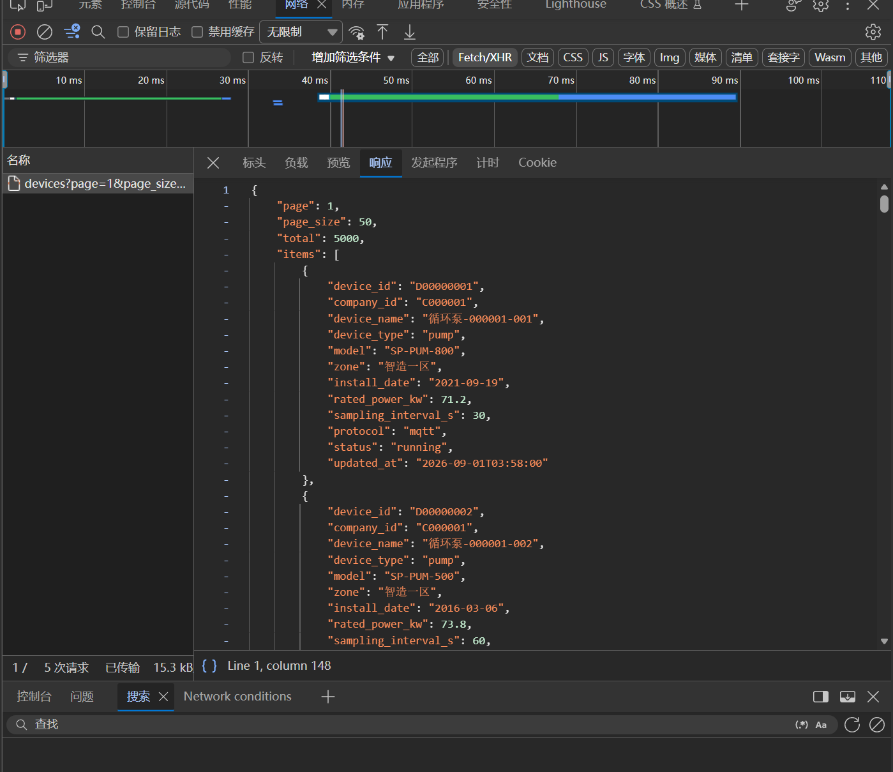
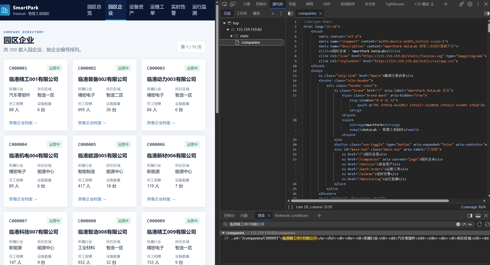
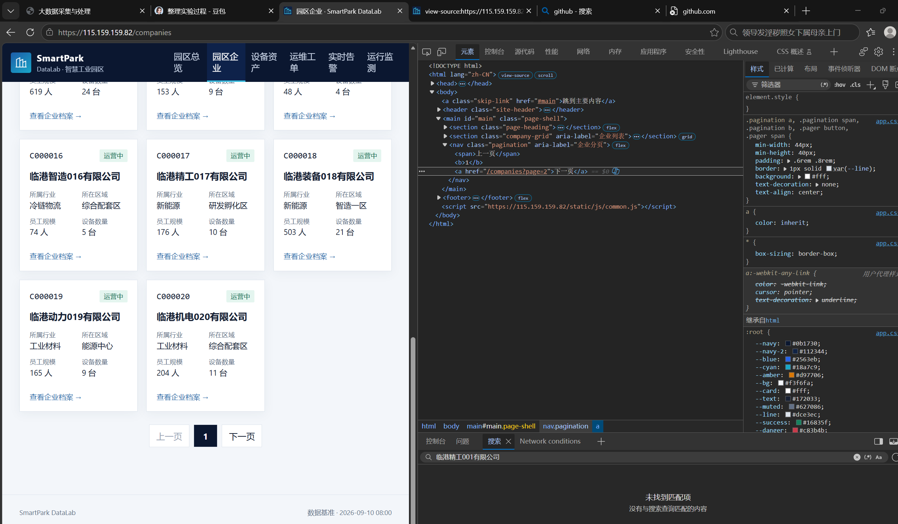
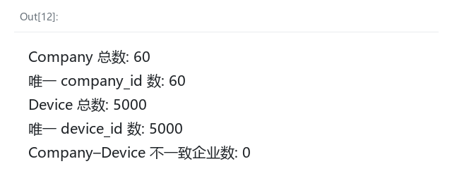

# Lab 1 实验报告

## 学生信息

- \*\*姓名：许宣
- \*\*学号：112404260126
- \*\*班级：数据1241
- \*\*GitHub 用户名：xuxuan
- \*\*仓库地址：<https://github.com/xuxuan-123-xu/bigdata-collection-labs-112404260126/upload/main>

> 文件位置：`lab01/REPORT.md`  
> 完整代码保存在 `lab1_html_api.ipynb`。  
> 本报告只填写关键发现、关键代码、结果和指定截图，**不要把整份 Notebook 复制进来**。

---

# 任务 1：判断数据加载方式

## 1.1 Device：判断动态加载并找到 API

### 判断结果

- 页面：`/devices`
- 数据加载方式：`静态加载 / 动态加载`
- 判断依据：网页打开后，单独发起 API 请求获取 JSON 格式设备数据，再渲染页面表格，HTML 原始页面不包含设备列表数据，因此是动态加载。

请用 1～2 句话说明：

1. 在“查看网页源代码”中是否能搜索到页面上的设备名称；否
2. 在 Network 的 Fetch/XHR 中是否找到返回设备数据的请求。能

### API 信息

- Request URL：/api/devices
- Request Method：GET
- Query 参数：page=1, size=20

### 【截图 1】Device API 发现证据

文件名：

```text
images/01_device_api.png
```

**截图内容必须是浏览器 DevTools，不是 Jupyter 代码。**

截图中应能看清：

1. 浏览器的 **Network** 面板；
2. 已选中真正返回设备列表的 Fetch/XHR 请求；
3. 右侧 **Headers** 中的 Request URL；
4. Query String Parameters（或 URL 中的分页参数）。

> 不要截整个桌面；尽量裁剪到 Network 请求和右侧 Headers 区域。

插入：



---

## 1.2 Company：判断静态加载

- 页面：`/companies`
- 数据加载方式：`静态加载 / 动态加载`
- 判断依据：网页请求返回的原始 HTML 中直接包含企业列表数据，不需要额外调用接口获取数据，页面渲染时数据已经写在 HTML 源码内。

请说明：使用“右键 → 查看网页源代码”后，是否能搜索到页面中真实显示的企业名称。

### 【截图 2】Company 静态加载证据

文件名：

```text
images/02_company_source.png
```

**截图内容必须是“查看网页源代码”页面，不是 Elements，也不是 Jupyter。**

截图中应能看清：

1. 浏览器正在显示 `/companies` 的网页源代码；
2. 使用 `Ctrl + F` 搜索一个页面中真实存在的企业名称；
3. 源代码中能看到该企业名称或对应企业记录。

插入：



---

# 任务 2：Device API 分页采集

## 2.1 API 分页结构

填写你实际从 JSON 中观察到的字段：

| 含义   | JSON 字段   |
| ---- | --------- |
| 当前页  | page      |
| 每页条数 | page_size |
| 设备总数 | total     |
| 设备列表 | items     |

---

## 2.2 关键代码

只填写分页采集的核心部分，不要粘贴整个 Notebook。

```python
# 从第一页响应中读取分页信息
total = data["__total______________"]
page_size = data["____page_size_______"]

total_pages = __(total + page_size - 1) // page_size______

devices = []

for page in range(1, total_pages + 1):
    r = requests.get(
        api_url,
        params={
            "_page____": page,
            "__page_size___": page_size
        },
        timeout=10
    )

    page_data = r.json()
    page_items = page_data["___items______"]
    ____devices.extend(page_items)__________
```

---

## 2.3 采集结果

- 每页条数：50
- 设备总数：5000
- 程序计算得到的总页数：100
- 最终采集设备数：5000
- 唯一 `device_id` 数：5000

回答：

> 为什么总页数应由 API 返回的 `total` 和 `page_size` 计算，而不是直接在代码里写死？

答：> 后端的总数据量、每页返回条数可能发生变化。写死总页数会出现少采、多请求无效页码问题；根据接口返回的`total`、`page_size`动态计算，可以自动适配数据规模，保证采集完整。

---

# 任务 3：Company HTML 解析

## 3.1 企业记录 Selector

- 企业记录 selector：article.company-card
- 第 1 页企业记录数：20

说明为什么选择这个 selector：

- 主要使用了 `id / class / data-* / 父子层级` 中的哪一种？
- 是否参考过浏览器 Copy selector 或 AI？
- 最终为什么采用现在这个写法？

答：企业记录 selector 为`article.company-card`，第 1 页企业记录数为 20。
  
选择依据：主要使用 class 进行定位。没有直接使用浏览器 Copy selector。浏览器直接复制的选择器一般带有元素位置序号，页面结构微调就会抓取失败；`article.company-card`依靠卡片专属 class 匹配企业条目，语义明确，只匹配企业卡片，不依赖元素位置，代码更稳定健壮。

---

## 3.2 关键代码

只填写“记录定位 + 一条记录的关键字段”。

```python
cards = soup.select("__article.company-card___")

card = cards[0]

company_id = _card.get("data-company-id")__
name = __card.select_one("h2 a").get_text(strip=True)__
status = _card.select_one(".badge").get_text(strip=True)____________
```

行业、区域、设备数量使用 `dt/dd` 结构后，请写出你最终如何得到：

```python
industry = _card.select_one("dl dt:contains('所属行业') + dd").get_text(strip=True)_
zone = _card.select_one("dl dt:contains('所在区域') + dd").get_text(strip=True)_
device_count = _int(card.select_one("dl dt:contains('设备数量') + dd").get_text(strip=True).replace(" 台", ""))______
```

---

## 3.3 字段来源说明

任选 **2 个字段**说明：

1. 字段：company_id
   - 来自：`HTML 属性`
   - 使用的方法：card.get("data-company-id")
2. 字段：name
   - 来自：`文本`
   - 使用的方法：card.select_one("h2 a").get_text(strip=True)

---

# 任务 4：Company “下一页”分页

## 4.1 下一页元素

- “下一页” selector：
- 第 1 页 `href` 示例：

### 【截图 3】Company “下一页”元素

文件名：

```text
images/03_company_next.png
```

**截图内容必须是浏览器 DevTools 的 Elements 面板。**

截图中应能看清：

1. 页面底部“下一页”对应的 `<a>` 元素被选中；
2. 该元素的 `class`、`href` 等关键属性；
3. 能判断你为什么使用当前 selector。

> 不需要截 Python 代码；这一张图只证明你找到了正确的 DOM 元素。

插入：



---

## 4.2 关键代码

```python
next_link = soup.select_one("__.pagination a__________________________")

next_href = _______next_link.get("href")_________________________________

next_url = urljoin(
    current_url,
    _____next_href___________________________________________
)
```

再用 2～3 句话说明：

> 你的程序如何完成“当前页 → 找下一页 href → 请求下一页 → 再解析”的循环？

答：程序先请求当前页面并解析 HTML，使用选择器找到下一页链接，提取 href 属性，拼接得到完整的下一页 URL。随后请求这个新 URL，拿到新页面的 HTML 继续解析企业数据。循环持续执行，直到找不到下一页链接时终止。

---

## 4.3 三页采集结果

| 页码     | 企业数 |
| ------ | --: |
| 1      |  20 |
| 2      |  20 |
| 3      |  20 |
| **合计** |  60 |

- 唯一 `company_id` 数：60

---

# 任务 5：结果验证

## 5.1 最终结果

| 检查项                   | 结果 |
| --------------------- | -: |
| Company 总数            | 60 |
| 唯一 `company_id`       | 60 |
| Device 总数             | 60 |
| 唯一 `device_id`        | 60 |
| Company–Device 不一致企业数 |  0 |

### 【截图 4】最终验证结果

文件名：

```text
images/04_validation.png
```

**截图内容必须是 JupyterLab 的运行结果，不是代码截图，也不是浏览器截图。**

截图中应能同时看清以下输出：

```text
Company 总数
唯一 company_id 数
Device 总数
唯一 device_id 数
Company–Device 不一致企业数
```

建议把这几个 `print()` 放在同一个 Notebook 单元格中运行后截图。

插入：




---

## 5.2 一致性检查关键代码

只填写最关键的比较逻辑：

```python
from collections import Counter

device_counts = Counter(
    x["company_id"] for x in devices
)

mismatch_count = 0

for company in companies:
    cid = _______str(company["company_id"])___________________________________
    expected = ____int(company["device_count"])_________________________________
    actual = ____device_counts.get(cid, 0)

    if ________expected != actual:_____________________________________:
        mismatch_count += 1
```

回答：

> 为什么 `status_code == 200` 仍然不能说明“数据已经采集正确”？

答：200 只证明"请求通了"，不证明"数据对"。数据是否正确只能通过数量核对、ID 唯一性检查和跨数据源一致性验证来确认。

---

# 任务 6：保存采集结果

确认已经生成：

```text
data/companies.json
data/devices.json
```

填写：

- `companies.json`：`已生成`
- `devices.json`：`已生成`

不需要截图 JSON 全文，也不需要把 JSON 内容复制到报告。

---

# 实验结论

用 **80～150 字**总结：

1. 静态加载与动态加载页面的处理方式有什么不同；
2. HTML “下一页”分页和 API `page` 分页有什么不同；
3. 你使用了哪些方法验证采集结果。

答：静态加载页面的数据直接嵌入 HTML 源码，可直接解析页面内容；动态页面需要抓取接口 JSON 数据。HTML 分页通过解析页面里 “下一页” 链接跳转，API 分页直接修改请求参数 page 获取数据。本次实验通过统计总条数、校验唯一 id 数量，核对企业与设备数据一致性，完成采集结果验证。
